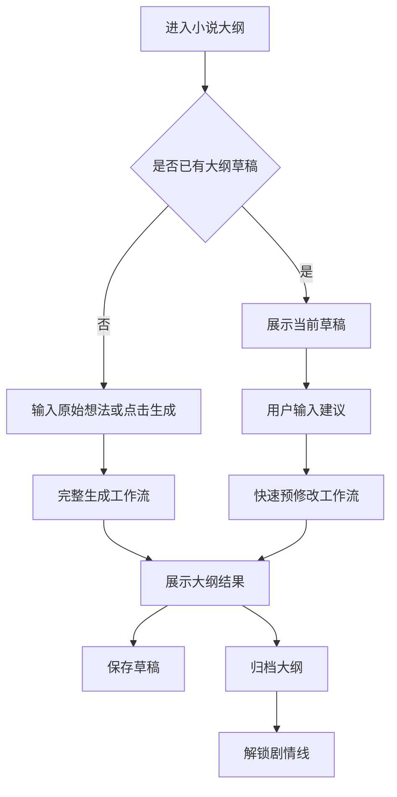

# H5 小说大纲步骤 UI 设计

## 设计目标

小说大纲是创作流程的第一步，用于生成并归档小说的标题、简介、整体大纲、世界观、修行体系、核心冲突和主要人物。该步骤没有上游依赖，完成归档后解锁“剧情线”。

用户建议来自底部输入框或语音转文字内容，作为 `UserSuggestion` 传入工作流；语音不会作为语音消息展示，只展示识别后的文字。

## 工作流匹配

| 模式 | 触发条件 | 后端流程 | UI 场景 |
| --- | --- | --- | --- |
| 完整生成 | `Genre + OriginalOutline` | `init -> generate -> expand -> polish -> review -> revise -> saveToDB` | 首次创建小说大纲 |
| 快速预修改 | `NovelID + Genre + UserSuggestion` | `init -> polish -> review -> revise -> saveToDB` | 用户基于已有大纲提出修改建议 |

## 布局图

```text
┌──────────────────────────────┐
│ ‹ 小说大纲                   │
│ 第 1 步 / 共 6 步 · 无依赖    │
├──────────────────────────────┤
│ 基础信息                     │
│ ┌──────────────────────────┐ │
│ │ 类型：玄幻                │ │
│ │ 标题：麒麟神座：万界商途 │ │
│ │ 简介：少年得万界商令……   │ │
│ └──────────────────────────┘ │
│                              │
│ 大纲内容                     │
│ ┌──────────────────────────┐ │
│ │ 整体大纲                 │ │
│ │ 世界观                   │ │
│ │ 修行体系                 │ │
│ │ 核心冲突                 │ │
│ │ 主要人物                 │ │
│ └──────────────────────────┘ │
│                              │
│ 审核建议                     │
│ ┌──────────────────────────┐ │
│ │ AI：核心冲突需要更聚焦。 │ │
│ └──────────────────────────┘ │
├──────────────────────────────┤
│ 🎙 输入你的大纲建议...  发送 │
│ [保存草稿]        [归档大纲] │
└──────────────────────────────┘
```

## 页面区域

| 区域 | 内容 | 说明 |
| --- | --- | --- |
| 顶部状态 | 步骤名、顺序、依赖状态 | 大纲无上游依赖，始终可创作 |
| 基础信息 | 类型、标题、简介 | 对应 `title`、`synopsis` 和小说类型 |
| 大纲内容 | 大纲、世界观、修行体系、核心冲突、主要人物 | 对应 `outline` 内层 JSON 的核心字段 |
| 审核建议 | AI 审核后的修改建议 | review 节点只展示建议，不直接覆盖内容 |
| 输入区 | 文字输入、语音输入、发送 | 输入内容就是用户建议 `UserSuggestion` |
| 操作区 | 保存草稿、归档大纲 | 保存不解锁下一步，归档后解锁剧情线 |

## 交互流程



## 用户建议输入

- 输入框占位文案：“输入你的大纲建议，例如：主角目标更明确，反派更有压迫感”。
- 点击麦克风后进入“正在听你说话...”状态，识别完成后将文字回填输入框。
- 点击发送后，输入内容作为 `UserSuggestion` 进入快速预修改工作流。
- 如果用户建议与已生成内容冲突，审核建议区域展示中文说明，并优先保留用户建议方向。

## 归档规则

- 归档前必须至少包含标题、简介、整体大纲、世界观、修行体系、核心冲突和主要人物。
- 归档按钮文案为“归档大纲”，确认弹窗说明：“归档后将解锁剧情线，后续步骤会基于当前大纲创作。”
- 修改已归档大纲时必须警告：“修改大纲会影响剧情线、关键人物、分卷、章节和正文。”
- 重新归档后，后续所有步骤标记为“需复核”。

## 需要的 API

| 场景 | 方法 | 路径 | 说明 |
| --- | --- | --- | --- |
| 获取大纲步骤 | GET | `/api/h5/novels/{novel_id}/steps/outline` | 返回草稿、归档版和审核建议 |
| 完整生成大纲 | POST | `/api/h5/novels/{novel_id}/steps/outline/generate` | 使用类型和原始想法生成大纲 |
| 提交用户建议 | POST | `/api/h5/novels/{novel_id}/steps/outline/messages` | 输入框或语音文字作为 `UserSuggestion` |
| 保存大纲草稿 | PUT | `/api/h5/novels/{novel_id}/steps/outline/draft` | 保存当前内容，不解锁下一步 |
| 归档大纲 | POST | `/api/h5/novels/{novel_id}/steps/outline/archive` | 归档后解锁剧情线 |
| 语音转文字 | POST | `/api/h5/speech/transcriptions` | 返回识别文本 |

## 验收标准

- 页面明确展示小说大纲是第 1 步，且无上游依赖。
- 用户建议只能来自输入框或语音转文字结果。
- 大纲内容至少覆盖五个核心内层字段。
- 保存草稿不解锁剧情线，归档大纲才解锁剧情线。
- 修改已归档大纲前必须展示影响后续步骤的警告。
