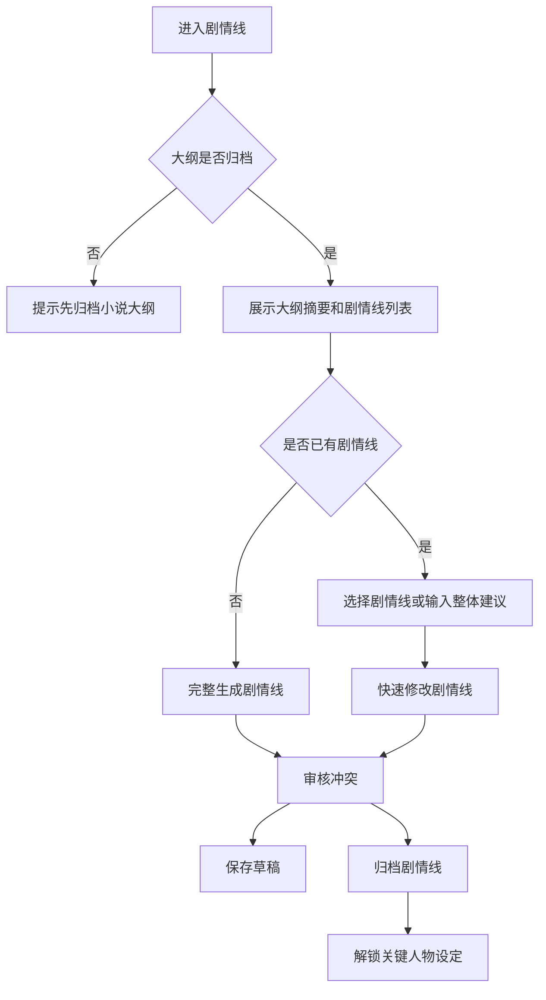

# H5 剧情线步骤 UI 设计

## 设计目标

剧情线是创作流程的第二步，用于基于已归档小说大纲生成主线、支线和角色相关剧情线。该步骤必须在“小说大纲”归档后才能进入，完成归档后解锁“关键人物设定”。

用户建议来自底部输入框或语音转文字内容，作为 `UserSuggestion` 传入工作流；快速修改时可指定某条剧情线，也可让 AI 判断需要联动调整的关联剧情线。

## 工作流匹配

| 模式 | 触发条件 | 后端流程 | UI 场景 |
| --- | --- | --- | --- |
| 完整生成 | `NovelID` | `init -> generate -> polish -> review -> revise -> saveToDB` | 首次从大纲生成剧情线集合 |
| 快速修改 | `PlotlineID + UserSuggestion` | `init -> polish -> review -> revise -> saveToDB` | 修改单条剧情线及必要关联剧情线 |

## 布局图

```text
┌──────────────────────────────┐
│ ‹ 剧情线                     │
│ 第 2 步 / 共 6 步 · 依赖大纲 │
├──────────────────────────────┤
│ 上游摘要：小说大纲           │
│ ┌──────────────────────────┐ │
│ │ 世界观、核心冲突、主角目标│ │
│ │ 摘要……                   │ │
│ └──────────────────────────┘ │
│                              │
│ 剧情线列表                   │
│ ┌──────────────────────────┐ │
│ │ ● 主线｜万界商途崛起     │ │
│ │ active · 贯穿全书        │ │
│ └──────────────────────────┘ │
│ ┌──────────────────────────┐ │
│ │ ○ 支线｜宗门旧怨         │ │
│ │ active · 中期爆发        │ │
│ └──────────────────────────┘ │
│                              │
│ 审核提示                     │
│ ┌──────────────────────────┐ │
│ │ AI：支线与主线转折需对齐 │ │
│ └──────────────────────────┘ │
├──────────────────────────────┤
│ 🎙 输入剧情线建议...    发送 │
│ [保存草稿]      [归档剧情线] │
└──────────────────────────────┘
```

## 页面区域

| 区域 | 内容 | 说明 |
| --- | --- | --- |
| 顶部状态 | 步骤名、顺序、依赖状态 | 未归档大纲时不可进入 |
| 上游摘要 | 大纲归档版摘要 | 用于提醒剧情线必须服从大纲 |
| 剧情线列表 | 类型、描述、状态 | 对应 `plotlines` 输出契约 |
| 审核提示 | 冲突说明、修改建议 | 展示 `review_suggestions` 或 `conflict_notes` |
| 输入区 | 用户建议 | 输入内容作为 `UserSuggestion` |
| 操作区 | 保存草稿、归档剧情线 | 归档后解锁关键人物设定 |

## 交互流程



## 用户建议输入

- 输入框占位文案：“输入剧情线建议，例如：让宗门旧怨提前埋伏笔”。
- 选中某条剧情线后发送建议，优先按该剧情线执行快速修改。
- 未选中剧情线时发送建议，可作为整体剧情线调整建议。
- 语音输入识别完成后只回填文字，不展示语音条。
- 若建议导致剧情线冲突，审核提示必须用中文说明冲突点和推荐修正方向。

## 归档规则

- 归档前剧情线列表不能为空，且至少包含一条主线。
- 归档按钮文案为“归档剧情线”，确认弹窗说明：“归档后将解锁关键人物设定，角色设定会基于当前剧情线生成。”
- 修改已归档剧情线时警告：“修改剧情线会影响关键人物、分卷、章节和正文。”
- 重新归档后，后续步骤标记为“需复核”。

## 需要的 API

| 场景 | 方法 | 路径 | 说明 |
| --- | --- | --- | --- |
| 获取剧情线步骤 | GET | `/api/h5/novels/{novel_id}/steps/plotlines` | 返回大纲摘要、剧情线草稿和归档版 |
| 完整生成剧情线 | POST | `/api/h5/novels/{novel_id}/steps/plotlines/generate` | 基于已归档大纲生成剧情线 |
| 提交用户建议 | POST | `/api/h5/novels/{novel_id}/steps/plotlines/messages` | 可携带 `plotline_id` 和 `UserSuggestion` |
| 保存剧情线草稿 | PUT | `/api/h5/novels/{novel_id}/steps/plotlines/draft` | 保存当前剧情线集合 |
| 归档剧情线 | POST | `/api/h5/novels/{novel_id}/steps/plotlines/archive` | 归档后解锁关键人物设定 |
| 语音转文字 | POST | `/api/h5/speech/transcriptions` | 返回识别文本 |

## 验收标准

- 未归档小说大纲时不能进入剧情线创作。
- 页面展示大纲摘要，提醒剧情线依赖大纲。
- 用户建议来自输入框或语音转文字结果。
- 快速修改支持指定单条剧情线，并允许联动关联剧情线。
- 归档剧情线后才解锁关键人物设定。
