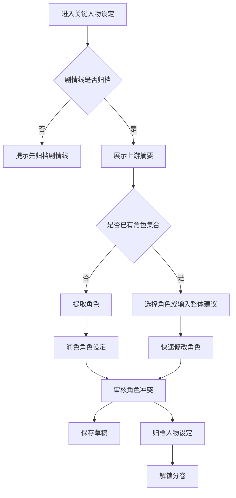

# H5 关键人物设定步骤 UI 设计

## 设计目标

关键人物设定是创作流程的第三步，用于从已归档大纲和剧情线中提取、补全并归档角色集合。该步骤必须在“剧情线”归档后才能进入，完成归档后解锁“分卷”。

用户建议来自底部输入框或语音转文字内容，作为 `UserSuggestion` 传入工作流；快速修改时可指定某个角色，也可提出整体人物关系调整建议。

## 工作流匹配

| 模式 | 触发条件 | 后端流程 | UI 场景 |
| --- | --- | --- | --- |
| 完整工作流 | `NovelID` | `init -> extract -> polish -> review -> revise -> saveToDB` | 首次提取和生成角色集合 |
| 快速修改 | `NovelID + CharacterID + UserSuggestion` | `init -> polish -> review -> revise -> saveToDB` | 修改指定角色及必要关系 |

## 布局图

```text
┌──────────────────────────────┐
│ ‹ 关键人物设定               │
│ 第 3 步 / 共 6 步 · 依赖剧情线│
├──────────────────────────────┤
│ 上游摘要：大纲 + 剧情线       │
│ ┌──────────────────────────┐ │
│ │ 主线目标、核心冲突、角色  │ │
│ │ 相关剧情线摘要……         │ │
│ └──────────────────────────┘ │
│                              │
│ 角色列表                     │
│ ┌──────────────────────────┐ │
│ │ 主角｜陆玄                │ │
│ │ 目标：掌控万界商路        │ │
│ │ 性格：沉稳、冒险、重承诺  │ │
│ └──────────────────────────┘ │
│ ┌──────────────────────────┐ │
│ │ 反派｜沈夜                │ │
│ │ 动机：夺取商令            │ │
│ │ 关系：亦敌亦师            │ │
│ └──────────────────────────┘ │
│                              │
│ 审核提示：关系冲突、动机缺口 │
├──────────────────────────────┤
│ 🎙 输入人物建议...      发送 │
│ [保存草稿]      [归档人物设定]│
└──────────────────────────────┘
```

## 页面区域

| 区域 | 内容 | 说明 |
| --- | --- | --- |
| 顶部状态 | 步骤名、顺序、依赖状态 | 未归档剧情线时不可进入 |
| 上游摘要 | 大纲和剧情线摘要 | 保证人物服务剧情线和核心冲突 |
| 角色列表 | 姓名、角色定位、目标、性格、关系 | 对应 `characters` 输出契约 |
| 审核提示 | 与大纲、剧情线、关系相关的冲突 | 展示 AI 审核建议 |
| 输入区 | 用户建议 | 输入内容作为 `UserSuggestion` |
| 操作区 | 保存草稿、归档人物设定 | 归档后解锁分卷 |

## 交互流程



## 用户建议输入

- 输入框占位文案：“输入人物建议，例如：给反派增加更强的私人动机”。
- 点击角色卡片后发送建议，优先修改该角色。
- 未选择角色时发送建议，按整体角色关系或角色集合调整处理。
- 语音识别结果直接回填输入框，用户确认后发送。
- 如果建议与大纲或剧情线冲突，审核提示展示中文说明。

## 归档规则

- 归档前角色列表不能为空，且主角必须存在。
- 每个核心角色应至少包含姓名、定位、目标、性格和关系摘要。
- 归档按钮文案为“归档人物设定”，确认弹窗说明：“归档后将解锁分卷，分卷会基于当前人物设定安排角色成长。”
- 修改已归档人物设定时警告：“修改人物设定会影响分卷、章节和正文。”
- 重新归档后，下游步骤标记为“需复核”。

## 需要的 API

| 场景 | 方法 | 路径 | 说明 |
| --- | --- | --- | --- |
| 获取人物步骤 | GET | `/api/h5/novels/{novel_id}/steps/characters` | 返回上游摘要、角色草稿和归档版 |
| 完整提取人物 | POST | `/api/h5/novels/{novel_id}/steps/characters/generate` | 从大纲和剧情线提取角色集合 |
| 提交用户建议 | POST | `/api/h5/novels/{novel_id}/steps/characters/messages` | 可携带 `character_id` 和 `UserSuggestion` |
| 保存人物草稿 | PUT | `/api/h5/novels/{novel_id}/steps/characters/draft` | 保存角色集合 |
| 归档人物设定 | POST | `/api/h5/novels/{novel_id}/steps/characters/archive` | 归档后解锁分卷 |
| 语音转文字 | POST | `/api/h5/speech/transcriptions` | 返回识别文本 |

## 验收标准

- 未归档剧情线时不能进入人物设定创作。
- 页面展示大纲和剧情线摘要。
- 用户建议来自输入框或语音转文字结果。
- 快速修改支持指定角色，也支持整体关系调整。
- 归档人物设定后才解锁分卷。
