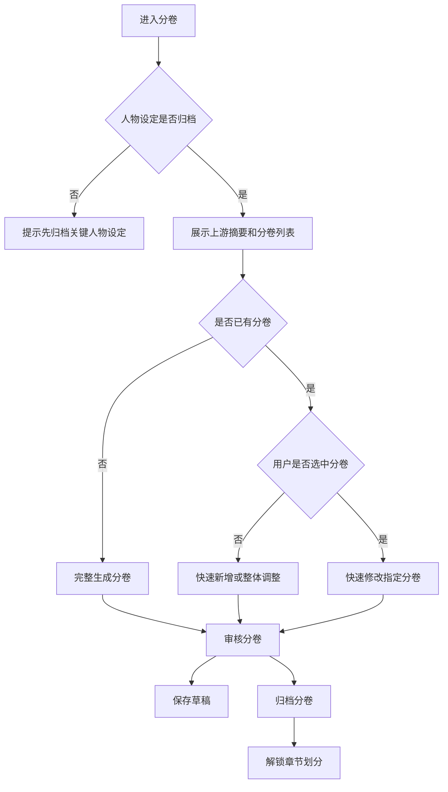

# H5 分卷步骤 UI 设计

## 设计目标

分卷是创作流程的第四步，用于基于已归档大纲、剧情线和人物设定规划小说卷结构。该步骤必须在“关键人物设定”归档后才能进入，完成归档后解锁“章节划分”。

用户建议来自底部输入框或语音转文字内容，作为 `UserSuggestion` 传入工作流；可用于新增分卷、修改指定分卷或调整整体卷节奏。

## 工作流匹配

| 模式 | 触发条件 | 后端流程 | UI 场景 |
| --- | --- | --- | --- |
| 完整工作流 | `NovelID` | `init -> generate -> polish -> review -> revise -> saveToDB` | 首次生成完整分卷列表 |
| 快速新增 | `NovelID + UserSuggestion` | `init -> polish -> review -> revise -> saveToDB` | 根据用户建议新增分卷 |
| 快速修改 | `NovelID + VolumeID + UserSuggestion` | `init -> polish -> review -> revise -> saveToDB` | 修改指定分卷 |

## 布局图

```text
┌──────────────────────────────┐
│ ‹ 分卷                       │
│ 第 4 步 / 共 6 步 · 依赖人物 │
├──────────────────────────────┤
│ 上游摘要：大纲/剧情线/人物    │
│ ┌──────────────────────────┐ │
│ │ 世界观阶段、主线推进、    │ │
│ │ 核心角色成长摘要……       │ │
│ └──────────────────────────┘ │
│                              │
│ 分卷列表                     │
│ ┌──────────────────────────┐ │
│ │ 第一卷：万界商令          │ │
│ │ 主题：获得商令与入局      │ │
│ │ 目标：完成主角初始成长    │ │
│ └──────────────────────────┘ │
│ ┌──────────────────────────┐ │
│ │ 第二卷：宗门旧债          │ │
│ │ 主题：支线冲突集中爆发    │ │
│ └──────────────────────────┘ │
│                              │
│ 审核提示：卷节奏、冲突覆盖   │
├──────────────────────────────┤
│ 🎙 输入分卷建议...      发送 │
│ [保存草稿]        [归档分卷] │
└──────────────────────────────┘
```

## 页面区域

| 区域 | 内容 | 说明 |
| --- | --- | --- |
| 顶部状态 | 步骤名、顺序、依赖状态 | 未归档人物设定时不可进入 |
| 上游摘要 | 大纲、剧情线、人物摘要 | 避免只看大纲而忽略已有铺垫 |
| 分卷列表 | 卷名、主题、简介、分卷大纲 | 对应 `volumes` 输出契约 |
| 审核提示 | 卷节奏、剧情线覆盖、人物成长问题 | 展示审核建议 |
| 输入区 | 用户建议 | 输入内容作为 `UserSuggestion` |
| 操作区 | 保存草稿、归档分卷 | 归档后解锁章节划分 |

## 交互流程



## 用户建议输入

- 输入框占位文案：“输入分卷建议，例如：新增一卷专门处理宗门旧怨”。
- 未选中分卷时发送建议，默认作为新增分卷或整体结构调整。
- 选中某个分卷时发送建议，作为指定分卷修改。
- 语音识别结果直接回填输入框，用户确认后发送。
- 用户建议与大纲、剧情线或人物成长冲突时，审核提示展示中文说明。

## 归档规则

- 归档前分卷列表不能为空，卷顺序必须清晰。
- 每个分卷应至少包含卷名、主题、简介和分卷大纲。
- 归档按钮文案为“归档分卷”，确认弹窗说明：“归档后将解锁章节划分，章节会基于当前分卷结构生成。”
- 修改已归档分卷时警告：“修改分卷会影响章节划分和正文。”
- 完整重新生成分卷可能覆盖旧分卷；UI 必须在执行前提示用户确认。

## 需要的 API

| 场景 | 方法 | 路径 | 说明 |
| --- | --- | --- | --- |
| 获取分卷步骤 | GET | `/api/h5/novels/{novel_id}/steps/volumes` | 返回上游摘要、分卷草稿和归档版 |
| 完整生成分卷 | POST | `/api/h5/novels/{novel_id}/steps/volumes/generate` | 基于已归档上游内容生成分卷 |
| 提交用户建议 | POST | `/api/h5/novels/{novel_id}/steps/volumes/messages` | 可携带 `volume_id` 和 `UserSuggestion` |
| 保存分卷草稿 | PUT | `/api/h5/novels/{novel_id}/steps/volumes/draft` | 保存分卷列表 |
| 归档分卷 | POST | `/api/h5/novels/{novel_id}/steps/volumes/archive` | 归档后解锁章节划分 |
| 语音转文字 | POST | `/api/h5/speech/transcriptions` | 返回识别文本 |

## 验收标准

- 未归档人物设定时不能进入分卷创作。
- 页面展示大纲、剧情线和人物摘要。
- 用户建议来自输入框或语音转文字结果。
- 支持快速新增分卷和指定分卷修改。
- 归档分卷后才解锁章节划分。
