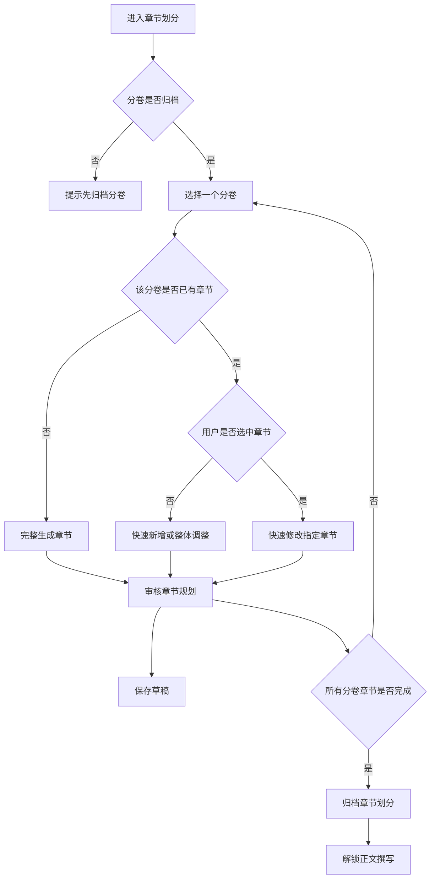

# H5 章节划分步骤 UI 设计

## 设计目标

章节划分是创作流程的第五步，用于基于已归档分卷、剧情线和人物设定生成每个分卷下的章节规划。该步骤必须在“分卷”归档后才能进入，完成归档后解锁“正文撰写”。

用户建议来自底部输入框或语音转文字内容，作为 `UserSuggestion` 传入工作流；可用于新增章节、修改指定章节或重新划分某个分卷。

## 工作流匹配

| 模式 | 触发条件 | 后端流程 | UI 场景 |
| --- | --- | --- | --- |
| 完整工作流 | `NovelID + VolumeID` | `init -> generate -> polish -> review -> revise -> saveToDB` | 为指定分卷完整生成章节列表 |
| 快速新增 | `NovelID + VolumeID + UserSuggestion` | `init -> polish -> review -> revise -> saveToDB` | 根据建议新增章节 |
| 快速修改 | `NovelID + VolumeID + ChapterID + UserSuggestion` | `init -> polish -> review -> revise -> saveToDB` | 修改指定章节规划 |

## 布局图

```text
┌──────────────────────────────┐
│ ‹ 章节划分                   │
│ 第 5 步 / 共 6 步 · 依赖分卷 │
├──────────────────────────────┤
│ 分卷选择                     │
│ [第一卷] [第二卷] [第三卷]    │
│                              │
│ 上游摘要：当前分卷           │
│ ┌──────────────────────────┐ │
│ │ 主题：获得商令与入局      │ │
│ │ 关键剧情线：万界商途崛起  │ │
│ └──────────────────────────┘ │
│                              │
│ 章节列表                     │
│ ┌──────────────────────────┐ │
│ │ 第 1 章 商令初现          │ │
│ │ 事件：主角获得万界商令    │ │
│ │ 预估：3000 字             │ │
│ └──────────────────────────┘ │
│ ┌──────────────────────────┐ │
│ │ 第 2 章 暗市风波          │ │
│ │ 事件：第一次交易冲突      │ │
│ └──────────────────────────┘ │
├──────────────────────────────┤
│ 🎙 输入章节建议...      发送 │
│ [保存草稿]      [归档章节划分]│
└──────────────────────────────┘
```

## 页面区域

| 区域 | 内容 | 说明 |
| --- | --- | --- |
| 顶部状态 | 步骤名、顺序、依赖状态 | 未归档分卷时不可进入 |
| 分卷选择 | 已归档分卷列表 | 章节划分以分卷为单位 |
| 上游摘要 | 当前分卷主题、剧情线、人物 | 避免章节规划脱离上游结构 |
| 章节列表 | 章节号、标题、简介、大纲、关键事件、预估字数 | 对应章节输出契约 |
| 输入区 | 用户建议 | 输入内容作为 `UserSuggestion` |
| 操作区 | 保存草稿、归档章节划分 | 所有分卷章节归档后解锁正文撰写 |

## 交互流程



## 用户建议输入

- 输入框占位文案：“输入章节建议，例如：在第 3 章增加一次失败交易”。
- 未选中章节时发送建议，默认作为新增章节或当前分卷整体调整。
- 选中章节后发送建议，作为指定章节修改。
- 语音识别结果直接回填输入框，用户确认后发送。
- 用户建议不得破坏章节号连续、剧情线推进和角色出场逻辑。

## 归档规则

- 每个已归档分卷都必须完成章节划分后，才能归档整个章节步骤。
- 章节号必须从 1 开始且在当前分卷内连续唯一。
- 每章应包含标题、简介、章节大纲、关键事件、关键角色和预估字数。
- 归档按钮文案为“归档章节划分”，确认弹窗说明：“归档后将解锁正文撰写，正文会基于当前章节规划生成。”
- 修改已归档章节划分时警告：“修改章节划分会影响已写正文。”
- 完整重新划分某卷时可能覆盖该卷旧章节，UI 必须提示用户确认。

## 需要的 API

| 场景 | 方法 | 路径 | 说明 |
| --- | --- | --- | --- |
| 获取章节步骤 | GET | `/api/h5/novels/{novel_id}/steps/chapters` | 返回分卷列表、章节草稿和归档状态 |
| 获取分卷章节 | GET | `/api/h5/novels/{novel_id}/volumes/{volume_id}/chapters` | 返回指定分卷章节列表 |
| 完整生成章节 | POST | `/api/h5/novels/{novel_id}/volumes/{volume_id}/chapters/generate` | 为指定分卷生成章节规划 |
| 提交用户建议 | POST | `/api/h5/novels/{novel_id}/volumes/{volume_id}/chapters/messages` | 可携带 `chapter_id` 和 `UserSuggestion` |
| 保存章节草稿 | PUT | `/api/h5/novels/{novel_id}/steps/chapters/draft` | 保存章节规划草稿 |
| 归档章节划分 | POST | `/api/h5/novels/{novel_id}/steps/chapters/archive` | 全部分卷完成后归档 |
| 语音转文字 | POST | `/api/h5/speech/transcriptions` | 返回识别文本 |

## 验收标准

- 未归档分卷时不能进入章节划分。
- 章节划分必须以分卷为单位展示和操作。
- 用户建议来自输入框或语音转文字结果。
- 支持快速新增章节和指定章节修改。
- 所有分卷章节完成并归档后才解锁正文撰写。
