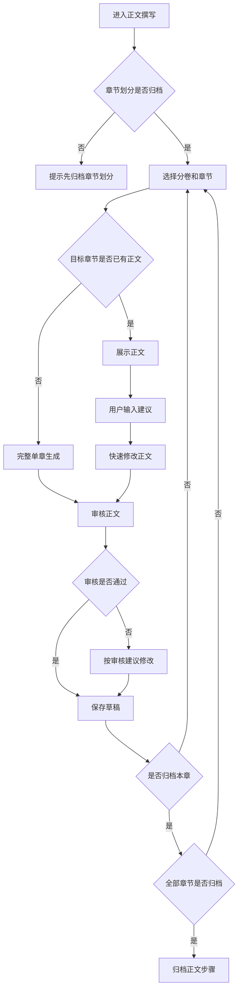

# H5 正文撰写步骤 UI 设计

## 设计目标

正文撰写是创作流程的第六步，用于基于已归档大纲、分卷、章节规划、剧情线和人物设定生成章节正文。该步骤必须在“章节划分”归档后才能进入，正文默认以单章为最小创作单位，避免一次性生成整卷导致上下文漂移。

用户建议来自底部输入框或语音转文字内容，作为 `UserSuggestion` 传入工作流；快速修改时只修改目标章节正文，不改变章节规划字段。

## 工作流匹配

| 模式 | 触发条件 | 后端流程 | UI 场景 |
| --- | --- | --- | --- |
| 完整单章正文 | `NovelID + VolumeID + ChapterID` | `init -> generate -> polish -> review -> route -> revise -> saveToDB` | 生成目标章节正文 |
| 快速修改 | `ChapterID + UserSuggestion` | `init -> polish -> review -> route -> revise -> saveToDB` | 修改已有章节正文 |
| 批量正文 | `NovelID + VolumeID` | `initBatch -> foreachChapter -> singleChapterWorkflow -> collectResult` | 按章节号顺序生成当前卷空正文 |

## 布局图

```text
┌──────────────────────────────┐
│ ‹ 正文撰写                   │
│ 第 6 步 / 共 6 步 · 依赖章节 │
├──────────────────────────────┤
│ 卷章选择                     │
│ [第一卷]  第 1 章 商令初现 ˅ │
│                              │
│ 章节规划                     │
│ ┌──────────────────────────┐ │
│ │ 目标：主角获得万界商令    │ │
│ │ 关键事件：暗市交易失败    │ │
│ │ 预估字数：3000            │ │
│ └──────────────────────────┘ │
│                              │
│ 正文内容                     │
│ ┌──────────────────────────┐ │
│ │ 夜色压在暗市低矮的檐角。 │ │
│ │ 陆玄握紧掌心的铜令……     │ │
│ │                          │ │
│ └──────────────────────────┘ │
│                              │
│ 审核提示：承接、字数、设定   │
├──────────────────────────────┤
│ 🎙 输入正文建议...      发送 │
│ [保存草稿]        [归档正文] │
└──────────────────────────────┘
```

## 页面区域

| 区域 | 内容 | 说明 |
| --- | --- | --- |
| 顶部状态 | 步骤名、顺序、依赖状态 | 未归档章节划分时不可进入 |
| 卷章选择 | 分卷、章节切换 | 正文以单章为最小单位 |
| 章节规划 | 章节标题、简介、大纲、关键事件、预估字数 | 正文必须覆盖章节规划 |
| 正文内容 | 目标章节正文 | 快速修改只更新正文相关字段 |
| 审核提示 | 大纲覆盖、上下文承接、人物一致性、字数偏差 | 展示 AI 审核建议 |
| 输入区 | 用户建议 | 输入内容作为 `UserSuggestion` |
| 操作区 | 保存草稿、归档正文 | 全部章节正文归档后作品进入完成态 |

## 交互流程



## 用户建议输入

- 输入框占位文案：“输入正文建议，例如：增加主角失败后的心理描写”。
- 用户必须先选择目标章节，再发送正文建议。
- 语音识别结果直接回填输入框，用户确认后发送。
- 用户建议可以调整描写、节奏、对话和局部剧情表现，但不能改变章节归属和章节规划字段。
- 如果用户建议与章节大纲或上游设定冲突，审核提示展示中文错误或修改建议。

## 批量生成入口

```text
┌──────────────────────────────┐
│ 当前卷还有 8 章未写正文       │
│ 批量生成会按章节号顺序执行，  │
│ 并使用上一章摘要承接上下文。  │
│                              │
│ [取消]          [批量生成空章]│
└──────────────────────────────┘
```

- 批量生成只是一章一章顺序执行单章工作流，不提供“一次生成整卷正文”的入口。
- 批量过程中任一章节失败时停止，并提示失败章节和原因。
- 批量生成必须按 `chapter_number` 升序执行，确保上下文承接正确。

## 归档规则

- 单章正文不能为空，且字数应尽量贴近章节预估字数。
- 保存前需要重新统计字数，不完全信任 AI 返回的字数。
- 快速修改只更新正文、字数、正文状态和更新时间，不改变章节规划字段。
- 归档按钮文案为“归档正文”，确认弹窗说明：“归档后该章节正文将作为后续章节承接上下文。”
- 修改已归档正文时警告：“修改正文会影响后续章节的承接和已生成内容。”
- 所有章节正文归档后，正文步骤可标记完成。

## 需要的 API

| 场景 | 方法 | 路径 | 说明 |
| --- | --- | --- | --- |
| 获取正文步骤 | GET | `/api/h5/novels/{novel_id}/steps/content` | 返回分卷、章节正文状态和当前章节内容 |
| 获取章节正文 | GET | `/api/h5/chapters/{chapter_id}/content` | 返回章节规划、正文、审核提示 |
| 生成单章正文 | POST | `/api/h5/chapters/{chapter_id}/content/generate` | 基于章节规划生成正文 |
| 提交用户建议 | POST | `/api/h5/chapters/{chapter_id}/content/messages` | 输入框或语音文字作为 `UserSuggestion` |
| 保存正文草稿 | PUT | `/api/h5/chapters/{chapter_id}/content/draft` | 保存正文，不改变章节规划 |
| 归档章节正文 | POST | `/api/h5/chapters/{chapter_id}/content/archive` | 归档单章正文 |
| 批量生成空章 | POST | `/api/h5/novels/{novel_id}/volumes/{volume_id}/content/batch-generate` | 按章节号顺序生成空正文 |
| 语音转文字 | POST | `/api/h5/speech/transcriptions` | 返回识别文本 |

## 验收标准

- 未归档章节划分时不能进入正文撰写。
- 正文撰写以单章为最小操作单位。
- 用户建议来自输入框或语音转文字结果。
- 快速修改不得改变章节规划字段。
- 批量生成按章节号顺序执行，失败后停止并给出中文原因。
- 所有章节正文归档后，正文步骤才可完成。
