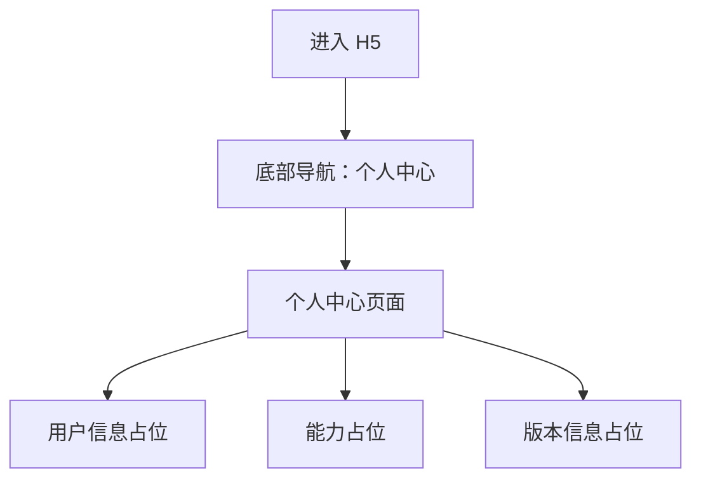

# H5 个人中心 UI 设计

## 设计目标

个人中心用于承载用户信息和未来账户能力。本期只展示占位信息，保证底部导航中“个人中心”可访问，同时不引入复杂设置项。

## 页面结构



## 视觉原则

- **信息克制**：只展示必要占位内容，不提前暴露未完成能力。
- **统一留白**：延续创作中心的白底、浅灰卡片和黑灰文字。
- **弱化操作**：本期不提供编辑资料、退出登录等真实操作，避免误导用户。
- **可扩展**：预留头像、昵称、账号 ID、设置入口的位置，方便后续迭代。

## 布局图

```text
┌──────────────────────────────┐
│ 个人中心                     │
│ 管理你的创作身份             │
├──────────────────────────────┤
│ ┌──────────────────────────┐ │
│ │  ◯                       │ │
│ │  创作者昵称              │ │
│ │  ID：--                  │ │
│ │  这里将展示用户简介      │ │
│ └──────────────────────────┘ │
│                              │
│ ┌──────────────────────────┐ │
│ │ 创作数据                 │ │
│ │ 作品数：--               │ │
│ │ 累计字数：--             │ │
│ └──────────────────────────┘ │
│                              │
│ ┌──────────────────────────┐ │
│ │ 更多能力                 │ │
│ │ 设置、会员、反馈等入口   │ │
│ │ 将在后续版本开放         │ │
│ └──────────────────────────┘ │
│                              │
├──────────────────────────────┤
│  创作中心              个人  │
└──────────────────────────────┘
```

## 内容说明

- 顶部标题固定为“个人中心”，副标题使用“管理你的创作身份”。
- 用户信息卡展示头像占位、昵称占位、用户 ID 占位和简介占位。
- 创作数据卡展示作品数、累计字数等占位数据，本期可全部显示 `--`。
- 更多能力卡只展示说明文字，不提供可点击功能，避免用户误触未完成入口。
- 未登录或用户信息获取失败时展示默认占位，不阻断页面访问。

## 交互状态

| 操作 | 触发方式 | 结果 |
| --- | --- | --- |
| 进入个人中心 | 点击底部“个人” | 展示个人中心占位页面 |
| 获取用户信息 | 页面初始化 | 成功则展示用户信息，失败则展示默认占位 |
| 返回创作中心 | 点击底部“创作中心” | 切换到小说列表界面 |

## 建议数据模型

### UserProfile

```json
{
  "id": "--",
  "nickname": "创作者昵称",
  "avatar_url": "",
  "bio": "这里将展示用户简介",
  "novel_count": null,
  "total_word_count": null
}
```

## 需要的 API

> 当前页面本期以占位展示为主，API 可先按可选能力接入；接口失败时前端仍展示默认占位。

| 场景 | 方法 | 路径 | 说明 |
| --- | --- | --- | --- |
| 获取当前用户信息 | GET | `/api/h5/me` | 返回头像、昵称、用户 ID、简介等基础信息 |
| 获取用户创作统计 | GET | `/api/h5/me/stats` | 返回作品数、累计字数等统计信息，可后续实现 |

## 前端埋点建议

| 事件 | 触发时机 | 关键字段 |
| --- | --- | --- |
| `profile_page_view` | 进入个人中心 | `user_id` |
| `profile_placeholder_show` | 使用默认占位 | `reason` |

## 验收标准

- 底部导航可以从创作中心切换到个人中心。
- 个人中心只展示占位用户信息，不包含未实现的真实操作。
- 用户信息接口失败时页面仍可正常展示。
- 页面风格与创作中心保持一致，整体极简、清晰、留白充足。
