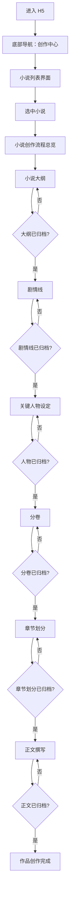

# H5 创作中心 UI 设计

## 设计目标

创作中心是 AI 小说项目的核心入口，采用极简主义设计承载“小说列表 + 创作流程工作台”。用户选中小说后不再直接进入聊天界面，而是进入该小说的创作流程总览，按小说大纲、剧情线、关键人物设定、分卷、章节划分、正文撰写六个步骤逐步完成创作。

每个步骤都依赖上一个步骤的归档结果：当前步骤完成并归档后，下一步骤才可进入。若用户要修改已归档内容，必须先看到明确警告，确认理解“修改归档内容会影响后续已经创作的内容”后才能继续。

## 页面结构



## 核心流程规则

| 顺序 | 步骤 | 依赖 | 未归档时状态 | 归档后解锁 |
| --- | --- | --- | --- | --- |
| 1 | 小说大纲 | 无 | 可创作 | 剧情线 |
| 2 | 剧情线 | 小说大纲已归档 | 锁定 | 关键人物设定 |
| 3 | 关键人物设定 | 剧情线已归档 | 锁定 | 分卷 |
| 4 | 分卷 | 关键人物设定已归档 | 锁定 | 章节划分 |
| 5 | 章节划分 | 分卷已归档 | 锁定 | 正文撰写 |
| 6 | 正文撰写 | 章节划分已归档 | 锁定 | 作品完成态 |

## 视觉原则

- **极简工作流**：白色背景、黑灰文字、浅灰分割线，用步骤状态替代复杂装饰。
- **单主任务**：每个页面只突出一个当前可做动作，避免“继续创作”直接跳过流程。
- **状态清晰**：步骤只使用三种状态：可创作、已归档、未解锁。
- **归档庄重**：归档按钮使用主按钮样式，表示阶段性确认，不和普通保存混淆。
- **风险前置**：修改已归档内容时使用独立警告弹窗，文案明确说明对下游内容的影响。
- **语音即文字**：步骤创作中的语音识别结果仍直接回填为文字，不展示语音消息样式。

## 小说列表界面

### 布局图

```text
┌──────────────────────────────┐
│ 创作中心                  ＋ │
│ 选择一部小说进入创作流程     │
├──────────────────────────────┤
│ ┌──────────────────────────┐ │
│ │ 麒麟神座：万界商途       │ │
│ │ 当前步骤：关键人物设定   │ │
│ │ 进度：2/6 已归档         │ │
│ │ 上次更新：今天 14:20     │ │
│ │                          │ │
│ │ [进入流程]          删除 │ │
│ └──────────────────────────┘ │
│ ┌──────────────────────────┐ │
│ │ 长夜之后                 │ │
│ │ 当前步骤：小说大纲       │ │
│ │ 进度：0/6 已归档         │ │
│ │ 上次更新：昨天 21:03     │ │
│ │                          │ │
│ │ [进入流程]          删除 │ │
│ └──────────────────────────┘ │
│                              │
├──────────────────────────────┤
│  创作中心              个人  │
└──────────────────────────────┘
```

### 内容说明

- 顶部标题固定为“创作中心”，副标题强调“选择一部小说进入创作流程”。
- 小说 item 不再展示“继续创作、归档”按钮，只保留“进入流程”和“删除”。
- item 展示当前步骤、已归档步骤数、最近更新时间，帮助用户判断创作进度。
- 点击小说卡片或“进入流程”进入创作流程总览，不直接进入聊天界面。
- 删除操作必须二次确认，确认文案使用中文：“删除后不可恢复，确认删除这部小说吗？”

## 小说创作流程总览

### 布局图

```text
┌──────────────────────────────┐
│ ‹ 麒麟神座：万界商途         │
│ 2/6 已归档 · 当前：关键人物  │
├──────────────────────────────┤
│ ┌──────────────────────────┐ │
│ │ ✓ 小说大纲               │ │
│ │ 已归档 · 可查看/申请修改 │ │
│ └──────────────────────────┘ │
│ ┌──────────────────────────┐ │
│ │ ✓ 剧情线                 │ │
│ │ 已归档 · 可查看/申请修改 │ │
│ └──────────────────────────┘ │
│ ┌──────────────────────────┐ │
│ │ ● 关键人物设定           │ │
│ │ 当前步骤 · 继续创作      │ │
│ └──────────────────────────┘ │
│ ┌──────────────────────────┐ │
│ │ ○ 分卷                   │ │
│ │ 请先归档关键人物设定     │ │
│ └──────────────────────────┘ │
│ ┌──────────────────────────┐ │
│ │ ○ 章节划分               │ │
│ │ 请先完成分卷             │ │
│ └──────────────────────────┘ │
│ ┌──────────────────────────┐ │
│ │ ○ 正文撰写               │ │
│ │ 请先完成章节划分         │ │
│ └──────────────────────────┘ │
└──────────────────────────────┘
```

### 内容说明

- 流程总览是选中小说后的默认页面，替代原先“直接进入聊天”的设计。
- 已归档步骤显示 `✓`，当前可创作步骤显示 `●`，未解锁步骤显示 `○`。
- 未解锁步骤可点击但不进入详情，只展示中文提示，例如：“请先归档关键人物设定，再开始分卷。”
- 已归档步骤可以查看内容；如果点击“修改”，必须先弹出影响警告。
- 当前步骤点击后进入步骤创作界面，使用该步骤专属上下文与 AI 协作。

## 步骤创作界面

### 布局图

```text
┌──────────────────────────────┐
│ ‹ 关键人物设定           ⋯  │
│ 依赖：剧情线已归档           │
├──────────────────────────────┤
│ 上游摘要                     │
│ ┌──────────────────────────┐ │
│ │ 剧情线归档版摘要……       │ │
│ └──────────────────────────┘ │
│                              │
│ 创作内容                     │
│ ┌──────────────────────────┐ │
│ │ 主角：陆玄                │ │
│ │ 目标：掌控万界商路……     │ │
│ │                          │ │
│ └──────────────────────────┘ │
│                              │
│ AI 协作                      │
│ ┌──────────────────────────┐ │
│ │ AI：建议补充反派动机……   │ │
│ └──────────────────────────┘ │
│                              │
├──────────────────────────────┤
│ 🎙  输入修改要求...      发送 │
│ [保存草稿]        [归档本步骤]│
└──────────────────────────────┘
```

### 语音输入状态图

```text
普通输入态
┌──────────────────────────────┐
│ 🎙  输入修改要求...      发送 │
└──────────────────────────────┘
          │ 点击/长按麦克风
          ▼
识别中
┌──────────────────────────────┐
│ ● 正在听你说话...       取消 │
└──────────────────────────────┘
          │ 识别完成
          ▼
文字回填态
┌──────────────────────────────┐
│ 帮我增加一个亦敌亦友角色 发送 │
└──────────────────────────────┘
```

### 内容说明

- 顶部展示返回按钮、当前步骤名称和更多菜单；更多菜单可预留“查看历史版本”。
- 上游摘要展示上一已归档步骤的关键内容，帮助用户理解当前步骤依赖。
- 创作内容区展示当前步骤草稿或归档版内容，是页面主体。
- AI 协作区只围绕当前步骤生成建议，不跨步骤直接修改后续内容。
- 底部固定输入区支持文字和语音，语音识别完成后只作为文字进入输入框。
- “保存草稿”只保存当前步骤内容，不解锁下一步骤。
- “归档本步骤”用于确认阶段成果，归档成功后返回流程总览并解锁下一步骤。

## 归档确认弹窗

### 布局图

```text
┌──────────────────────────────┐
│ 归档关键人物设定？           │
├──────────────────────────────┤
│ 归档后将解锁下一步“分卷”。   │
│ 后续创作会基于当前归档内容。 │
│                              │
│ 归档后仍可修改，但修改时会   │
│ 影响下游已经创作的内容。     │
├──────────────────────────────┤
│ 取消              确认归档   │
└──────────────────────────────┘
```

### 交互规则

- 用户点击“归档本步骤”时展示确认弹窗，避免误归档。
- 确认归档后，该步骤状态变为已归档，下一步骤状态变为可创作。
- 如果当前步骤内容为空或生成中，不允许归档，并提示：“请先完成当前步骤内容，再进行归档。”
- 已归档内容可查看，不默认进入编辑态。

## 修改已归档内容警告

### 布局图

```text
┌──────────────────────────────┐
│ 修改已归档内容？             │
├──────────────────────────────┤
│ 你正在修改“小说大纲”的归档版。│
│                              │
│ 修改归档内容会影响下面步骤   │
│ 已经创作的内容，包括剧情线、 │
│ 关键人物、分卷、章节和正文。 │
│                              │
│ 请确认你已经理解风险。       │
├──────────────────────────────┤
│ 取消        我理解，继续修改 │
└──────────────────────────────┘
```

### 交互规则

- 点击已归档步骤的“修改”时必须展示该警告，不能直接进入编辑态。
- 确认后进入该步骤编辑界面，并在页面顶部显示风险提示条：“正在修改归档内容，下游步骤可能需要重新检查。”
- 修改保存后，该步骤之后的所有步骤标记为“需复核”，但不自动删除用户内容。
- 若用户再次归档修改后的内容，系统提示用户检查所有下游步骤。
- 取消修改时保持原归档内容和流程状态不变。

## 步骤状态设计

| 状态 | 图标 | 用户可操作 | 说明 |
| --- | --- | --- | --- |
| 未解锁 | `○` | 查看锁定原因 | 上一步未归档，不能创作 |
| 可创作 | `●` | 进入创作、保存草稿、归档 | 当前唯一主任务 |
| 已归档 | `✓` | 查看、申请修改 | 可作为下游步骤依赖 |
| 需复核 | `!` | 查看、重新确认或修改 | 上游归档内容发生变化 |

## 交互状态

| 操作 | 触发方式 | 结果 |
| --- | --- | --- |
| 进入流程 | 点击小说 item 或“进入流程” | 进入小说创作流程总览 |
| 进入当前步骤 | 点击状态为可创作的步骤 | 进入对应步骤创作界面 |
| 点击未解锁步骤 | 点击状态为未解锁的步骤 | 展示缺失依赖提示，不进入创作界面 |
| 保存草稿 | 点击“保存草稿” | 保存当前步骤内容，流程状态不变 |
| 归档步骤 | 点击“归档本步骤”并确认 | 当前步骤变为已归档，解锁下一步骤 |
| 查看归档 | 点击已归档步骤 | 查看归档内容，只读展示 |
| 修改归档 | 点击已归档内容的“修改” | 先展示风险警告，确认后进入编辑态 |
| 发送文字 | 输入文本后点击发送 | 提交当前步骤的创作指令给 AI |
| 语音转文字 | 语音识别成功 | 将识别文本填入输入框，用户确认后发送 |

## 建议数据模型

### NovelListItem

```json
{
  "id": 1,
  "title": "麒麟神座：万界商途",
  "genre": "玄幻",
  "current_step": "characters",
  "archived_step_count": 2,
  "total_step_count": 6,
  "updated_at": "2026-05-21T14:20:00+08:00"
}
```

### CreationStep

```json
{
  "key": "characters",
  "name": "关键人物设定",
  "order": 3,
  "status": "active",
  "depends_on": "plotlines",
  "archived_version_id": null,
  "needs_review": false,
  "updated_at": "2026-05-21T14:20:00+08:00"
}
```

### StepContent

```json
{
  "novel_id": 1,
  "step_key": "characters",
  "draft_content": "主角：陆玄……",
  "archived_content": "",
  "upstream_summary": "剧情线归档版摘要……",
  "is_archived": false,
  "needs_review": false
}
```

### StepMessage

```json
{
  "id": "msg_001",
  "novel_id": 1,
  "step_key": "characters",
  "role": "user",
  "content": "帮我增加一个亦敌亦友角色。",
  "input_type": "text",
  "created_at": "2026-05-21T14:21:00+08:00"
}
```

## 需要的 API

> 当前仓库未看到现成 H5 HTTP 路由，以下为前端所需的建议 API，可在后端实现时按实际路由调整。

| 场景 | 方法 | 路径 | 说明 |
| --- | --- | --- | --- |
| 获取小说列表 | GET | `/api/h5/novels` | 返回当前步骤、已归档步骤数、更新时间 |
| 创建小说 | POST | `/api/h5/novels` | 创建新小说并初始化六个创作步骤 |
| 获取小说流程 | GET | `/api/h5/novels/{novel_id}/workflow` | 返回六个步骤状态、依赖关系和复核状态 |
| 获取步骤内容 | GET | `/api/h5/novels/{novel_id}/steps/{step_key}` | 返回草稿、归档内容、上游摘要 |
| 保存步骤草稿 | PUT | `/api/h5/novels/{novel_id}/steps/{step_key}/draft` | 只保存草稿，不改变流程状态 |
| 归档步骤 | POST | `/api/h5/novels/{novel_id}/steps/{step_key}/archive` | 归档当前步骤并解锁下一步骤 |
| 申请修改归档 | POST | `/api/h5/novels/{novel_id}/steps/{step_key}/edit-archived` | 记录用户已确认风险，进入编辑态 |
| 重新归档步骤 | POST | `/api/h5/novels/{novel_id}/steps/{step_key}/rearchive` | 修改后重新归档，并标记下游步骤需复核 |
| 获取步骤消息 | GET | `/api/h5/novels/{novel_id}/steps/{step_key}/messages` | 获取当前步骤 AI 协作记录 |
| 发送步骤消息 | POST | `/api/h5/novels/{novel_id}/steps/{step_key}/messages` | 发送当前步骤创作指令 |
| 流式生成回复 | GET | `/api/h5/novels/{novel_id}/steps/{step_key}/messages/stream` | SSE 流式返回 AI 内容 |
| 停止生成 | POST | `/api/h5/novels/{novel_id}/steps/{step_key}/messages/{message_id}/stop` | 中断当前 AI 生成 |
| 语音转文字 | POST | `/api/h5/speech/transcriptions` | 上传音频，返回识别文本 |
| 删除小说 | DELETE | `/api/h5/novels/{novel_id}` | 建议软删除 |

## 前端埋点建议

| 事件 | 触发时机 | 关键字段 |
| --- | --- | --- |
| `novel_workflow_enter` | 进入小说流程总览 | `novel_id`、`current_step` |
| `workflow_step_click` | 点击创作步骤 | `novel_id`、`step_key`、`status` |
| `workflow_step_locked_show` | 点击未解锁步骤 | `novel_id`、`step_key`、`depends_on` |
| `step_draft_save` | 保存步骤草稿 | `novel_id`、`step_key` |
| `step_archive_confirm` | 确认归档步骤 | `novel_id`、`step_key` |
| `archived_edit_warning_show` | 展示归档修改警告 | `novel_id`、`step_key` |
| `archived_edit_confirm` | 确认修改已归档内容 | `novel_id`、`step_key` |
| `step_message_send` | 发送步骤创作消息 | `novel_id`、`step_key`、`input_type` |
| `speech_transcription_success` | 语音识别成功 | `duration_ms`、`text_length` |

## 验收标准

- 进入创作中心默认展示小说列表。
- 选中小说后进入创作流程总览，不直接进入聊天界面。
- 创作流程固定为小说大纲、剧情线、关键人物设定、分卷、章节划分、正文撰写。
- 每个步骤必须在上一步归档后才能进入，未解锁步骤只能展示原因提示。
- 当前步骤可以保存草稿，但只有点击并确认“归档本步骤”后才解锁下一步。
- 修改已归档内容前必须展示中文警告，明确说明会影响后续已经创作的内容。
- 修改归档内容后，下游步骤应标记为“需复核”，但不自动删除用户内容。
- 语音输入完成后只展示识别出的文字，不展示语音消息样式。
- 页面整体保持极简风格，无复杂装饰和多余模块。
